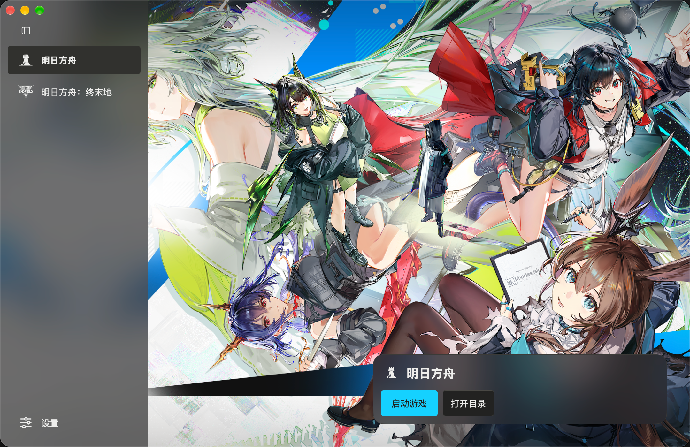
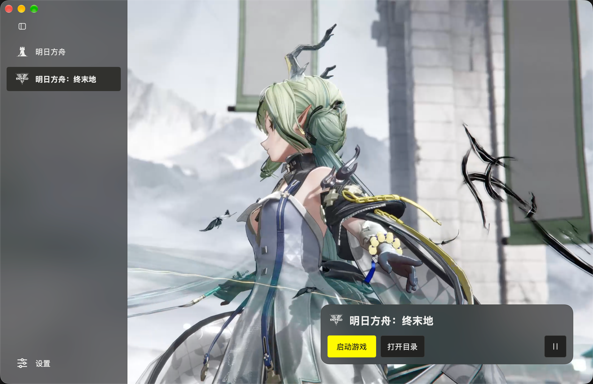

<p align="center">
  
</p>
<h1 align="center">Pinion</h1>
<p align="center">为 macOS 设计的鹰角游戏启动器</p>

Pinion 是面向 Apple Silicon Mac 的非官方启动器，目前支持《明日方舟》和《明日方舟：终末地》的国服官方 Windows 客户端。

## 目录

- [实机截图](#实机截图)
- [安装指引](#安装指引)
- [路线图](#路线图)
- [技术](#技术)
- [常见问题](#常见问题)
- [贡献指南](#贡献指南)
- [贡献者](#贡献者)
- [致谢](#致谢)
- [许可证](#许可证)

## 实机截图

| 明日方舟 | 明日方舟：终末地 |
| --- | --- |
|  |  |

## 安装指引

需要 **Apple Silicon Mac、macOS 15 或更新版本，以及 Rosetta 2**。

从 [GitHub Releases](https://github.com/DanielZhangyc/Pinion/releases/latest) 下载 DMG，将 `Pinion.app` 拖入“应用程序”目录即可使用。也可按[构建指南](CONTRIBUTING.md#构建应用)从源码构建。

如果 macOS 提示“应用已损坏”或阻止打开，确认安装包来自本仓库 Release 后，在终端执行：

```sh
xattr -dr com.apple.quarantine /Applications/Pinion.app
```

1. 首次打开，等待内置 FineWine 运行环境自动准备完成。缺少 Rosetta 时，按应用提示安装。
2. 在设置中选择游戏下载目录，进入游戏页下载所需游戏。
3. 下载完成后点击“启动游戏”。首次启动会自动创建容器；终末地还会联网准备官方启动组件。

Pinion 启动时会自动检查 [GitHub Release](https://github.com/DanielZhangyc/Pinion/releases) 中的稳定版更新，也可在设置中手动检查；发现新版后可打开发布页下载安装包。

## 路线图

- [x] 明日方舟 / 明日方舟：终末地启动
- [x] Retina 分辨率
- [x] 全量包下载、断点续传与解压校验
- [x] 内置 FineWine 与首次运行自动配置
- [x] 安装包发布与启动器更新检查
- [ ] B 服 / 国际服
- [ ] 泡姆泡姆
- [ ] MAA 支持（后续 fork MAA）
- [ ] Mod 加载支持
- [ ] ARM 版终末地适配（等待官方发布）
- [ ] 游戏自动更新、差分更新与预下载

## 技术

| 游戏 | 图形路径 |
| --- | --- |
| 明日方舟 | D3D11 → DXMT → Metal |
| 明日方舟：终末地 | Vulkan → MoltenVK → Metal |

## 常见问题

**能复用已有游戏吗？**

可在设置中选择已有的 Pinion 下载根目录。暂不支持导入其他启动器的安装，也不支持接管现有 Wine / CrossOver 容器。

**下载中断需要重下吗？**

保留原下载目录，重新打开后继续即可。

**支持自动更新游戏吗？**

目前支持全量下载，自动更新与预下载仍在开发计划中。

**运行环境准备或游戏启动失败怎么办？**

先检查网络、磁盘空间和 Rosetta。环境准备失败可在设置中重试；游戏启动失败可点击“查看日志”查看原因。

如无法解决问题，可附上日志提交 issue 反馈。

## 贡献指南

开发需要 macOS、Xcode 26 或更新版本、direnv、Go 和 MinGW-w64。在项目根目录运行：

```sh
direnv allow .
direnv exec . go mod download
make dev
```

提交前运行 `make check`。构建、目录说明和调试方法见 [CONTRIBUTING.md](CONTRIBUTING.md)；AI 辅助贡献请遵守 [LLM 使用政策](LLM_POLICY.md)。欢迎通过 Issue 反馈问题或提出建议，也欢迎提交 Pull Request。


## 致谢

- [MyGo](https://github.com/egoist/mygo)：Go 原生 UI 与应用构建工具。
- [FineWine](https://github.com/stoicswe/Endfield_FineWine) / [Wine](https://github.com/wine-mirror/wine)：Windows 游戏运行环境与兼容补丁。
- [DXMT](https://github.com/3Shain/dxmt) / [MoltenVK](https://github.com/KhronosGroup/MoltenVK)：图形转换组件。
- [Radix Colors](https://github.com/radix-ui/colors)：界面色板。
- 游戏标志与背景的来源见[第三方声明](resources/licenses/third-party.md)。

## 许可证

项目采用 [GPL-3.0-only](LICENSE)。第三方组件和素材遵循各自许可。

Pinion 与鹰角网络及其发行方没有隶属关系。游戏名称、标志和官方素材的权利属于各自权利人。
